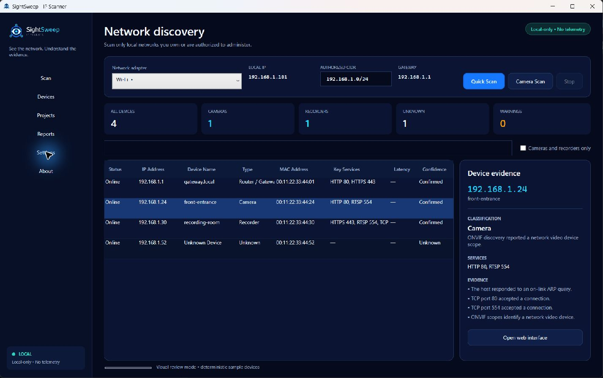
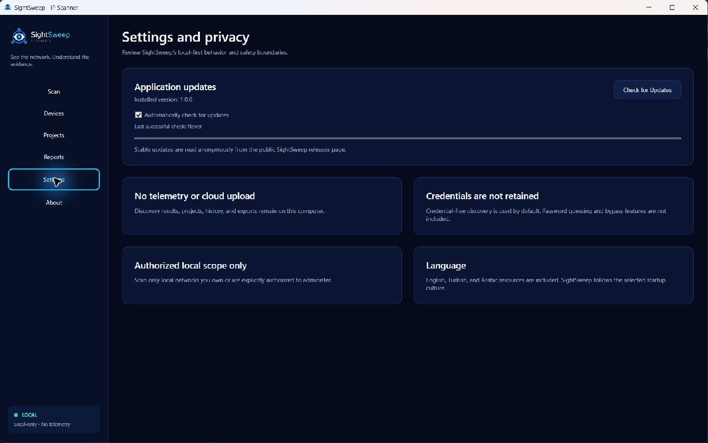

  

<h1 align="center">SightSweep - IP Scanner for Windows</h1>

  Fast, evidence-based discovery for local networks, IP cameras, NVRs, and DVRs.

  <a href="https://github.com/KlowzyZ/SightSweep/releases/latest"><strong>Download SightSweep 1.0.0</strong></a>

  
  
  

SightSweep is a local-first Windows IPv4 scanner. It discovers reachable devices on a network you are authorized to manage, keeps unknown devices visible by IP, and explains the evidence behind camera, recorder, router, computer, printer, and other classifications.

## Screenshots

## Features

- Progressive ARP, ICMP, bounded TCP, reverse-DNS, and ONVIF WS-Discovery.
- Unknown devices remain visible even when classification evidence is incomplete.
- Specialized evidence for IP cameras, NVRs, DVRs, ONVIF, RTSP, and common device services.
- Search, camera/recorder filtering, device details, and safe local web-interface links.
- Local projects, scan history, scan comparison, and credential-free CSV/JSON exports.
- Responsive cancellation and bounded concurrency; no Nmap, Npcap, driver, or administrator requirement for normal scans.
- English, Turkish, and Arabic localization with right-to-left Arabic layout.
- Keyboard navigation, visible focus, high contrast, and non-color status cues.

## Privacy and updates

Scan results, projects, history, and exports stay on your computer. SightSweep has no telemetry, analytics, advertisements, cloud upload, or account requirement.

Automatic stable-update checks are enabled by default and can be disabled in Settings. An update check sends only a normal anonymous HTTPS request for public release metadata; it never sends scan data. SightSweep opens the verified public release page and does not replace its executable in place.

Read [Privacy](PRIVACY.md) and [Privacy and security details](docs/privacy-and-security.md).

## Installation

1. Open the [latest release](https://github.com/KlowzyZ/SightSweep/releases/latest).
2. Download `SightSweep-v1.0.0-win-x64.exe` or the portable ZIP.
3. Verify the file against `SHA256SUMS.txt`.
4. Run `SightSweep.exe`. The build is self-contained and does not require a separately installed .NET runtime.

See the [getting-started guide](docs/getting-started.md) for usage and checksum commands.

## How discovery works

SightSweep first performs bounded local reachability discovery and shows devices immediately. It then enriches only discovered hosts with service and hostname evidence. Credential-free ONVIF WS-Discovery runs in parallel for authorized camera and recorder hardware. An open port alone is never treated as proof of a vendor or device type.

## Authorized use

Use SightSweep only on local networks and devices you own or are explicitly authorized to administer. It does not include password guessing, credential spraying, exploitation, bypass features, or Internet-wide scanning.

## Known limitations

- Sleeping devices, host firewalls, VLAN boundaries, Wi-Fi client isolation, routing, and disabled discovery protocols can hide otherwise connected devices.
- Version 1.0.0 focuses on IPv4. IPv6 discovery is not included.
- ONVIF detection is credential-free; devices with discovery disabled or isolated may not respond.
- Vendor/OUI lookup and embedded RTSP preview are not included in this release.
- Code signing is not yet available, so Windows may show a reputation warning for the first public build.

## License and repository model

SightSweep is proprietary freeware. The unmodified compiled application may be used for lawful personal and internal commercial administration under the included [EULA](EULA.txt). Redistribution, resale, modification, and source rights are not granted.

This public repository contains product documentation and release downloads only. The private application source and development history are not published here. Third-party components retain the licenses listed in [THIRD_PARTY_NOTICES.txt](THIRD_PARTY_NOTICES.txt).

## Support and security

Use GitHub Issues for redacted bug reports and feature requests. Report product security problems according to [SECURITY.md](SECURITY.md); never post credentials or private network inventories publicly.

## Developer

[Developed by KLOWZY](https://github.com/KlowzyZ)
