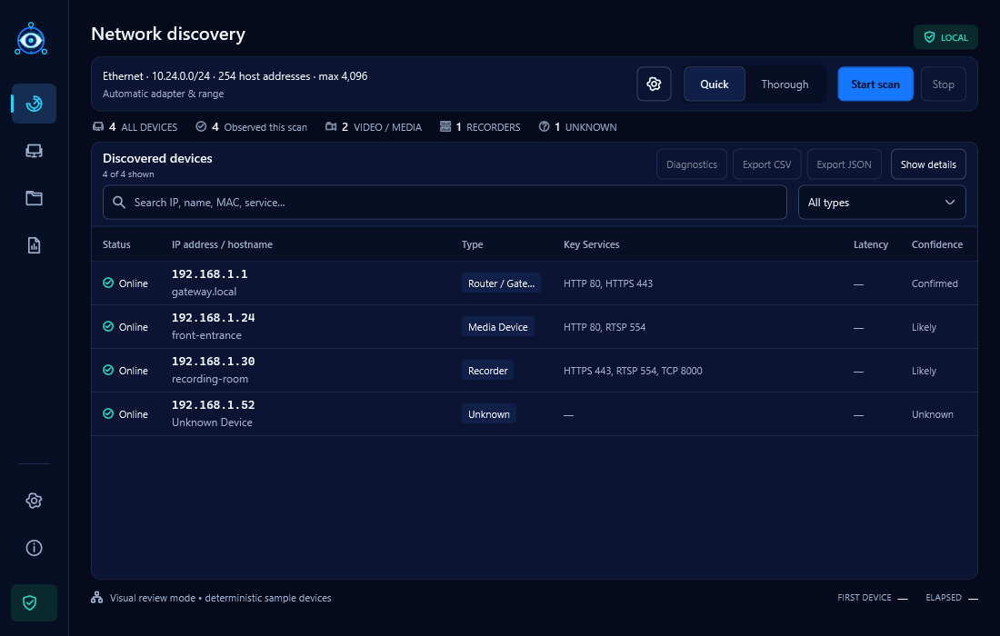

  

<h1 align="center">SightSweep - IP Scanner for Windows</h1>

  Fast, evidence-based discovery for local networks, IP cameras, NVRs, and DVRs.

  <strong>SightSweep 2.0.0 Stable</strong>

  
  
  

SightSweep is a local-first Windows IPv4 scanner. It discovers reachable devices on a network you are authorized to manage, keeps unknown devices visible by IP, and explains the evidence behind camera, recorder, router, computer, printer, and other classifications.

## Screenshots

Illustrative inventory using deterministic sample devices.

## Features

- Progressive ARP/neighbor, ICMP, bounded TCP, reverse-DNS, ONVIF WS-Discovery, SSDP and mDNS discovery, with optional NetBIOS enrichment.
- Unknown devices remain visible even when classification evidence is incomplete.
- Specialized evidence for IP cameras, NVRs, DVRs, ONVIF, RTSP, and common device services.
- Compact scan controls and summary, a prominent virtualized/resizable table, search/filtering, optional resizable evidence and safe local web-interface links.
- Local projects, saved networks, scan history/comparison, CSV/JSON exports and confirmed cross-scan identities with revision-protected labels/notes. IP reuse alone never links annotations.
- Quick/Thorough modes, selected adapter/source handling and CIDR or exact inclusive IPv4 ranges up to 4,096 hosts.
- Responsive cancellation and bounded concurrency; no Nmap, Npcap, driver, or administrator requirement for normal scans.
- English, Turkish, and Arabic localization with right-to-left Arabic layout.
- Keyboard navigation, visible focus, high contrast, and non-color status cues.

## Privacy and updates

Scan results, projects, history, and exports stay on your computer. SightSweep has no telemetry, analytics, advertisements, cloud upload, or account requirement.

Automatic Stable update checks are enabled for new profiles, run in the background and are throttled to approximately once every 24 hours. Explicit saved disabled preferences are retained. Checks can be disabled in Settings. An update check sends only a normal anonymous HTTPS request for public release metadata; it never sends scan data. SightSweep opens the public release page only when requested and never installs updates automatically.

Read [Privacy](PRIVACY.md) and [Privacy and security details](docs/privacy-and-security.md).

## Installation

1. Open the public `KlowzyZ/SightSweep` repository’s **Releases** section.
2. Download **SightSweep-v2.0.0-win-x64.exe** for the per-user installer, or **SightSweep-v2.0.0-win-x64.zip** for portable use.
3. Verify the file against `SHA256SUMS.txt`.
4. Close running SightSweep instances. The EXE installs per user without requesting administrator rights by default, creates a Start Menu shortcut and offers an optional desktop shortcut. For portable use, extract the whole ZIP and run SightSweep.exe. Both options bundle .NET.

Stable retains the original `%LOCALAPPDATA%\SightSweep` data root. Installation/uninstallation does not delete projects, history, annotations, settings or exports. Back up important data before upgrading. Preview data remains separate and is not automatically merged. Previous releases/assets remain available unchanged.

See the [getting-started guide](docs/getting-started.md) for usage and checksum commands.

## How discovery works

SightSweep first performs bounded local reachability discovery and shows devices immediately. It then enriches only discovered hosts with service and hostname evidence. Credential-free ONVIF WS-Discovery runs in parallel for authorized camera and recorder hardware. An open port alone is never treated as proof of a vendor or device type.

## Authorized use

Use SightSweep only on local networks and devices you own or are explicitly authorized to administer. It does not include password guessing, credential spraying, exploitation, bypass features, or Internet-wide scanning.

## Known limitations

- Sleeping devices, host firewalls, VLAN boundaries, Wi-Fi client isolation, routing, and disabled discovery protocols can hide otherwise connected devices.
- SightSweep 2.0 focuses on IPv4. IPv6 discovery is not included.
- ONVIF detection is credential-free; devices with discovery disabled or isolated may not respond.
- Vendor/OUI lookup and embedded RTSP preview are not included in this release.
- Code signing is not yet available; Windows reputation and organization policy may affect launch.
- Windows 11 x64 is the primary tested platform; the installer also permits Windows 10 22H2 x64. Exhaustive device, routing, OS/display/accessibility and enterprise deployment coverage is not claimed.

## License and repository model

SightSweep is proprietary freeware. The unmodified compiled application may be used for lawful personal and internal commercial administration under the included [EULA](EULA.txt). Redistribution, resale, modification, and source rights are not granted.

This public repository contains product documentation and release downloads only. The private application source and development history are not published here. Third-party components retain the licenses listed in [THIRD_PARTY_NOTICES.txt](THIRD_PARTY_NOTICES.txt).

## Support and security

Use GitHub Issues for redacted bug reports and feature requests. Report product security problems according to [SECURITY.md](SECURITY.md); never post credentials or private network inventories publicly.

## Developer

Developed by KLOWZY · [Official website](https://klowzy.com)
